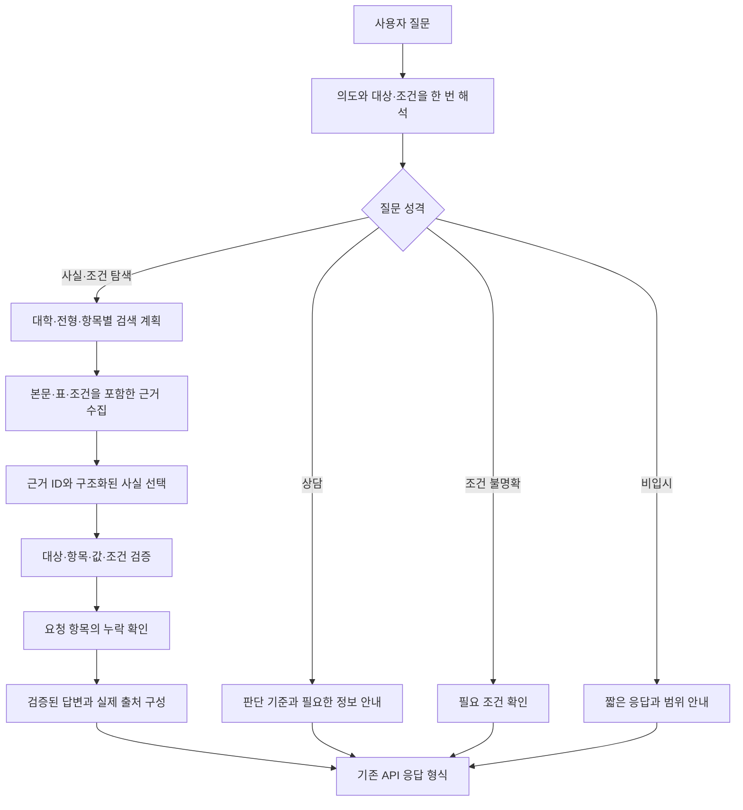

# 답변 품질 문제의 원인 분석과 해결 설계

| 항목 | 내용 |
| --- | --- |
| 작성일 | 2026.09.28 |
| 근거 | 23문항 실행 기록, 22문항 채점 결과, 현재 코드, 외부 호출 없는 최소 재현 |
| 작업 범위 | 질문 해석·검색·답변 생성·근거 검증의 개선 방법 분석 |
| 유지할 범위 | 기존 백엔드 API 규격 유지, 연도 관련 질문 지원 확대 제외 |
| 상태 | 분석 시점의 기록. 이후 적용 내용과 검증 결과는 [개선 적용 보고서](implementation_review_20260929.md) 참고 |

## 1. 결론

현재 품질 문제는 세 단계에서 연결된다.

1. 질문에 필요한 정보가 일부 빠지면 검색을 건너뛰고 일반 답변으로 이동한다.
2. 검색한 경우에도 표의 구조와 요청한 세부 항목이 충분히 보존되지 않는다.
3. 생성 이후 검증은 원문 문자열과 숫자 포함 여부에 치우쳐 정상 답변을 버리거나, 대상이 다른 답변을 통과시킬 수 있다.

**우선 해결할 문제는 모든 대학별 사실 답변에 근거 확인을 적용하고, 한 번 해석한 질문을 검색까지 일관되게 전달하는 것이다.** 이후 표와 날짜의 검증, 복합 질문의 누락 방지를 개선한다.

모델 교체나 추가 학습의 효과는 이 단계별 문제를 교정한 뒤 측정한다. 현재 자료만으로 모델 교체의 개선 폭을 예측할 수 없다.

## 2. 확인된 문제와 근거

### 2.1 정보가 하나만 비어도 검색을 건너뛴다

**확인한 코드**

- `extract_all.py:291`의 `final_bucket()`은 대학·전형·키워드가 모두 있어야 문서 검색으로 분류한다.
- `search_and_export.py:310`의 검색 함수는 이 분류가 아니면 검색 전에 반환한다.
- `generate_answers.py`의 `answer_one()`은 검색 분류가 아닌 질문을 일반 LLM 답변으로 보낸다.

**실제 영향**

- 11번은 대학과 컴공을 인식했지만 전형이 비어 검색하지 않았다.
- 18번은 대학과 자유전공공학부를 인식했지만 전형이 비어 검색하지 않았다.
- 13·16·17번처럼 대학이 없는 조건 검색은 시작할 수 없었다.
- 3번은 KU일반학생이라는 명칭을 대학·전형으로 연결하지 못했다.

**추가 확인**

`normalize_type('논술')`은 이미 `수시`를 반환한다. 다만 이 함수는 추출된 전형을 경로로 변환할 때 사용되고, 추출 결과가 빈 경우를 검색 분류 전에 보완하지 못한다. 사전이 전혀 없는 문제보다 적용 순서와 정보 전달의 문제가 크다.

**해결 방법**

- 질문의 의도와 추출 정보의 완성도를 분리한다.
- 대학별 사실 질문은 근거가 필요한 질문으로 분류하고, 정보가 부족하면 검색 범위를 넓히거나 필요한 조건을 확인한다.
- 대학만 명확하면 해당 대학의 보유 수시·정시 자료를 후보로 삼는다. 대학이 없는 조건 탐색은 보유 대학 범위에서 검색한다.
- 대학별로 확인된 전형 명칭 사전을 만든다. KU일반학생처럼 문서에서 확인된 명칭만 연결하고, `일반전형` 같은 공통 명칭만으로 대학을 단정하지 않는다.
- `학생부`라는 단어를 무조건 수시로 바꾸는 일괄 규칙은 피한다. 원문의 명시 전형과 해당 대학 자료를 우선한다.

### 2.2 질문을 여러 번 해석하고, 보정 과정에서 정보를 잃는다

**확인한 코드**

- `run_single_turn()`이 NER를 추출한 뒤 `answer_one()`을 호출한다.
- `search_top_pages_for_query()`에서 다시 NER를 추출한다. 앞 단계의 보정 결과를 직접 받지 않는다.
- `apply_explicit_followup_rules()`는 정시가 있으면 정시만 남기는 `if/elif`를 사용한다.
- 명시 항목이 발견되면 기존 `KEYWORD` 전체를 새 항목 목록으로 덮어쓴다.

**최소 재현 결과**

입력 문장: `서울대 수시랑 정시에서 컴퓨터공학부 몇명 뽑아`

| 구분 | 전형 | 키워드 |
| --- | --- | --- |
| 보정 전 | 수시, 정시 | 컴퓨터공학부 |
| 보정 후 | 정시 | 모집인원 |

수시와 학과 정보가 보정 함수에서 사라졌다. 평가 5번의 최종 결과에서는 뒤의 재추출 결과로 일부 복원됐으므로, 이 현상만을 그 문항 실패의 단독 원인으로 단정하지 않는다. 다만 같은 질문을 단계마다 다르게 처리할 수 있는 결함은 재현됐다.

**해결 방법**

- 질문을 한 번 해석해 내부 검색 계획으로 전달한다.
- 대학, 수시·정시, 세부 전형, 모집단위, 요청 항목, 수치 조건을 별도로 보존한다.
- 명시적인 새 정보는 관련 필드에만 반영한다. 모집인원을 찾았다고 학과명을 삭제하지 않는다.
- 원문도 함께 보존한다. 재검색 시 대학·전형·키워드만 이어 붙여 질문을 대체하지 않는다.
- 19번처럼 과거 목표나 배경 설명에 나온 학과와 현재 질문 대상을 구분한다. 구분이 불명확하면 대학·학과의 연결을 확정하지 않는다.

### 2.3 근거 검증을 통과하지 않는 별도 생성 경로가 있다

**확인한 현상**

인용 검증은 문서 기반 답변에만 적용된다. 일반 답변과 키워드 답변 경로는 검증 없이 최종 응답을 반환한다. 11번의 최저기준 오답과 19번의 물리 미이수 불이익 추측이 이 경로에서 발생했다.

**해결 방법**

- 답변 전 공통 규칙을 둔다. 대학별 모집인원·지원자격·전형기준 등은 검증된 근거가 있어야 출력한다.
- 근거가 필요한 질문을 검색하지 못했을 때 일반 LLM이 해당 사실을 채워 넣지 않도록 한다.
- 상담에서는 비교 기준과 필요한 정보만 안내하고, 대학별 유불리나 개인 합격 가능성은 근거 없이 생성하지 않는다.
- 근거 부족, 조건 불명확, 검증 실패를 내부적으로 구분한다. 최종 안내도 가능한 범위에서 이 차이를 반영한다.

**우선순위: 최우선.** 다른 개선으로 답변 수를 늘리기 전에 이 경로를 정리해야 한다.

### 2.4 인용 검증이 정상 정보는 탈락시키고 다른 대상의 정보는 통과시킨다

**확인한 코드**

`llm/evidence.py`는 인용문이 페이지에 있는지 확인하고, 답변의 숫자 집합이 인용문의 숫자 집합에 포함되는지 검사한다.

**확인된 한계**

| 사례 | 현재 동작 | 문제 |
| --- | --- | --- |
| `12.29.`와 `12월 29일` | 숫자 추출 결과가 각각 `{12.29}`, `{12, 29}` | 같은 날짜 표기가 다르게 취급됨 |
| 정시 36명의 표를 문장형 인용으로 재작성 | 원문 연속 문자열과 불일치 | 실제 존재하는 정답이 탈락함 |
| 인용은 컴퓨터공학부 36명, 답변은 경영학과 36명 | 검증 통과 | 학과와 숫자의 관계를 확인하지 못함 |

마지막 사례는 이번 분석에서 만든 합성 입력으로 재현했다. 실제 23문항에서 같은 오류가 관찰됐다는 뜻은 아니다.

**해결 방법**

1. 검색 단계에서 원문 구간에 근거 ID를 부여한다. 문서·페이지·구간 위치·원문을 코드가 보관한다.
2. LLM에는 원문 인용을 다시 작성시키는 대신 사용할 근거 ID를 선택하게 한다.
3. 숫자는 날짜·시간·비율·인원·등급으로 나눠 해석한다. 모든 점이나 구두점을 제거하는 방식은 사용하지 않는다.
4. 답변의 대학·세부 전형·모집단위·항목·값·단위·적용 조건이 선택한 근거와 연결되는지 확인한다.
5. 모집인원·반영비율처럼 구조화할 수 있는 값은 검증한 자료로 문장을 직접 구성한다.
6. 서술형 조건은 원문 조건과 예외를 보존한다. 추가 LLM 검토는 보조 수단으로 활용하되 독립적인 정확성 보장으로 취급하지 않는다.

**주의:** 근거 ID만 사용해도 학과 혼동은 남을 수 있다. ID 도입과 대상·항목·값 검증을 함께 해야 한다. 날짜 표기 처리는 기존 일정 답변의 검증 개선이며 연도 질문 지원 확대를 뜻하지 않는다.

### 2.5 페이지 검색만으로 표와 복합 질문을 충분히 처리하지 못한다

**확인한 코드와 데이터**

- 검색은 페이지 전체의 TF-IDF와 키워드 포함 점수를 중심으로 한다.
- 모집인원 별칭이 적용된 경우 숫자가 많이 나온 페이지를 우선하는 보정도 있다. 숫자가 많다는 사실은 정답 표가 있다는 증거가 아니다.
- 대학·전형별 상위 페이지 수가 제한돼 여러 요청 항목 중 일부가 밀릴 수 있다.
- 표 CSV는 존재하지만 일부 셀에 여러 행이 줄바꿈으로 묶여 있다. 그대로 정확한 행·열 데이터로 간주할 수 없다.

**해결 방법**

- 문서의 절·제목·본문·표를 구분하고, 표에는 전형 제목·열 이름·행 이름·각주를 함께 연결한다.
- 우선 모집인원·전형방법·제출서류·수능최저·일정에 대해 검증 가능한 자료 구조를 만든다.
- 실제 PDF와 표 추출 결과가 일치하는지 확인한다. 행·열 연결이 불명확한 표는 임의 해석하지 않는다.
- 복합 질문은 항목별로 검색한다. 예를 들어 전형방법과 제출서류는 각각 근거를 확보한다.
- 비교 질문은 대학·전형 조합을 유지한다. 9번의 연세대 정시와 고려대 수시를 서로 바꾸거나 모든 조합으로 확장하지 않는다.
- 답변 전 각 대상·항목이 충족됐는지 확인한다. 누락이 있으면 해당 항목에 한해 추가 검색한다.

검색 방식 변경의 효과는 정답 근거가 후보에 들어오는 비율과 잘못된 근거가 상위에 오는 비율로 측정한다. 임베딩이나 재순위화 모델을 추가하기 전에 현재 자료와 기준 검색의 실패를 분리해 측정한다.

### 2.6 상담·탐색·자료 부족을 같은 방식으로 처리한다

**확인한 현상**

- 대학 비교와 합격 가능성 질문이 대부분 단순 거절로 끝났다.
- 대학 미지정 조건 탐색은 문서 검색으로 연결되지 않았다.
- “나 심심해”도 확인할 수 없는 사항으로 응답했다.
- 현재 프롬프트는 되묻기를 금지하고, 최종 정리 함수도 질문형 마무리를 제거한다. 필요한 조건 확인을 도입한다면 이 정책도 함께 조정해야 한다.

**해결 방법**

| 질문 성격 | 권장 처리 |
| --- | --- |
| 대학별 사실 | 관련 문서 검색 → 근거 검증 → 답변 |
| 조건에 맞는 전형 탐색 | 보유 대학 범위 검색 → 비율·실기 여부 등 조건 검증 → 확인된 사례 제시 |
| 대학 선택·지원 상담 | 우열·합격 확률을 단정하지 않고 성적·전공·비용 등 판단 기준 안내 |
| 대상이 불명확한 질문 | 필요한 조건 하나를 구체적으로 확인하거나 명시적인 범위로 제한해 답변 |
| 입결·경쟁률 등 별도 자료가 필요한 질문 | 해당 자료의 보유 여부 확인 → 없으면 필요한 자료와 한계를 안내 |
| 비입시 대화 | 짧게 반응하고 입시 안내 범위로 자연스럽게 전환 |

경쟁률·충원·합격 백분위 자료가 현재 충분히 있는지는 별도 자료 점검이 필요하다. 보고서의 확인 불가 응답만으로 자료가 없다고 단정할 수 없다. 자료가 실제로 없다면 검색 알고리즘 개선만으로 그 질문을 해결할 수 없다.

## 3. 제안하는 내부 처리 흐름

이 설계의 내부 객체와 단계별 상태는 외부 API 필드로 추가할 필요가 없다. 기존 응답 형식과 연결되는 부분에서 변환하면 된다.

## 4. 실행 순서와 완료 기준

| 순서 | 작업 | 주 변경 대상 | 완료 기준 |
| --- | --- | --- | --- |
| 1 | 검색 없는 대학별 사실 생성 차단 | generate_answers.py | 11·19번과 변형 질문에서 근거 없는 대학별 단정이 나오지 않음 |
| 2 | 질문 해석 단일화·정보 보존 | generate_answers.py, extract_all.py, search_and_export.py | 수시·정시와 학과·요청 항목이 동시에 유지됨. 배경 학과를 현재 대상으로 바꾸지 않음 |
| 3 | 부족 정보에 따른 검색·확인 분기 | 검색 계획 및 명칭 매핑 | 3·11·18번이 관련 근거에 도달하거나 정확한 조건 확인으로 연결됨 |
| 4 | 근거 ID와 형식별 값 검증 | llm/evidence.py, 문서 문맥 구성 | 5번의 정시 36명을 복원하면서 다른 학과 36명은 거부. 날짜·소수·비율을 구분 |
| 5 | 표 구조·항목별 검색 보강 | 문서 검색 및 자료 전처리 | 2·4·9번의 요청 항목별 근거 확보 여부를 추적 가능 |
| 6 | 상담·조건 탐색 응답 | 질문 의도 처리와 응답 정책 | 6~8·10·13·16·17·23번이 해당 유형에 맞게 처리됨 |
| 7 | 동일 기준 재평가 | evaluations 및 회귀 테스트 | 기존 문항과 신규 변형 문항에서 개선 전후 결과·근거·보류 원인 비교 |

숫자 검증만 완화하거나 “답변을 꼭 하라”는 프롬프트를 추가하는 변경은 선행하지 않는다. 정상 답변 누락을 줄이면서 잘못된 대상·수치가 통과하지 않는지를 함께 확인해야 한다.

## 5. 재평가 설계

### 유지할 기준

- 기존 22개 채점 문항과 12번 제외 기준을 유지한다.
- 기존 답변과 생성 원응답은 덮어쓰지 않고 비교 기준으로 보관한다.
- 완전 정답, 부분 충족, 보류, 오답을 그대로 구분한다.

### 보완할 측정

- **사실 질문:** 근거가 있는 문항의 정답률, 잘못된 수치·조건 비율.
- **검색:** 필요한 근거 페이지·구간이 후보에 포함되는 비율.
- **검증:** 정상 주장 탈락과 잘못된 주장 통과를 각각 측정.
- **복합 질문:** 대학·전형·항목별 누락률.
- **상담:** 조건에 맞는 판단 기준 제공 여부와 근거 없는 합격 예측 여부.
- **보류:** 자료 부족, 조건 불명확, 검색 실패, 인용 검증 실패를 분리.

### 반드시 추가할 반례

1. 같은 숫자가 다른 학과에 존재하는 표.
2. 수시와 정시를 동시에 묻는 질문.
3. 학과와 모집인원·제출서류를 동시에 묻는 질문.
4. 날짜의 점 표기와 자연어 표기, 소수 배점이 섞인 문서.
5. “타 학교를 목표로 했다”는 배경과 현재 지원 대상을 함께 말하는 질문.
6. 자료에 없는 경쟁률·입결을 요구하는 질문.
7. 전형명이 모호하거나 여러 대학에서 쓰이는 질문.

실제 모델 평가는 여러 차례 반복해 변동을 확인하고, 수정에 사용하지 않은 별도 질문도 평가한다. 현재 결과에서 향후 정답률을 수치로 예측하지 않는다.

## 6. 검토 범위

이번 분석에서는 서비스 코드를 변경하거나 실제 LLM을 다시 호출하지 않았다. 코드와 저장된 실행 결과를 확인했고, 로컬 함수 호출로 날짜 숫자 추출, 검색 분류, 정보 손실, 다른 학과 주장의 검증 통과를 재현했다. 해결 설계의 효과는 구현 후 평가해야 한다.
